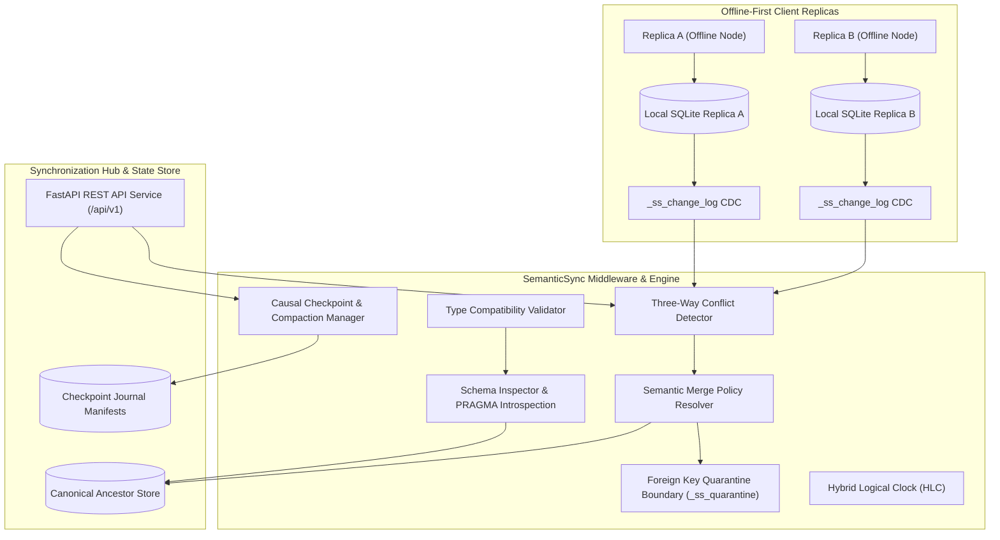

# SemanticSync 🔄

> **A developer workspace for designing, querying, and synchronizing local-first relational databases with schema-level semantic merge policies.**

---

## 💡 Core Philosophy & Thesis

- **Keep SQL and SQLite:** The underlying storage tier remains standard, embedded SQLite. Developers continue writing ordinary SQL schemas, queries, and transactions.
- **The Core Thesis:** ***Convergence does not equal semantic correctness.*** Traditional CRDT engines achieve state convergence through arbitrary tie-breaking heuristics such as Last-Write-Wins (LWW). While replicas reach identical bytes, valid transactions are silently destroyed (e.g. concurrent sales overwritten instead of added).
- **Domain Independence:** SemanticSync operates purely on relational schemas, SQL datatypes, and declarative merge policies (`SUM`, `BOUNDED_SUM`, `AVG`, `APPEND`, `LWW`, and `REJECT`), never hardcoding business assumptions.

---

## 🏗️ System Architecture



---

## 🚀 Key Features

### 1. Schema-Level Semantic Policies
- **`SUM`**: Additive delta reconciliation from the common ancestor ($v_{\text{base}} + \Delta_A + \Delta_B$) for numeric fields (e.g., inventory counts, account balances).
- **`BOUNDED_SUM`**: Additive delta execution with strict upper and lower bounding semi-lattices (e.g. inventory clamped to `[0, 1000]`).
- **`AVG`**: Arithmetic mean reconciliation for statistical observations (e.g., sensor telemetry, clinical vital signs).
- **`APPEND`**: Multi-author text concatenation with HLC-ordered delimiters, preserving concurrent contributions.
- **`LWW`**: Last-Write-Wins based on Hybrid Logical Clock timestamps with deterministic replica ID tie-breaking.
- **`REJECT`**: Strict safety latch that holds conflicting updates in a pending review state for human intervention (e.g., patient blood types, security roles).
- **`MIN` / `MAX`**: Idempotent extremum bounds.

### 2. Tombstone Merge Policies
Resolves concurrent updates vs. deletions:
- **`FLAG_FOR_REVIEW` (Default)**: Preserves both the update and the deletion in held conflict records for administrative decision.
- **`DELETE_WINS`**: Deletion takes precedence over concurrent updates.
- **`UPDATE_RESURRECTS`**: Concurrent update re-inserts and resurrects the deleted record.

### 3. Transactional Foreign-Key Isolation Boundary
- Operates under strict SQLite foreign-key enforcement (`PRAGMA foreign_keys = ON`).
- When a parent record is deleted or modified concurrently, orphaned child records are atomically migrated into `_ss_quarantine` rather than cascading unmonitored deletions.
- Full quarantine inspection, parent relinking (`relink`), and archive confirmation (`confirmed_deleted`) endpoints.

### 4. Operational Checkpoints & Causal Compaction
- Prevents unbounded growth of `_ss_change_log`.
- Computes common acknowledgment horizons across registered replicas.
- **Safety Guarantee:** Compaction is fail-closed. If any enrolled replica's acknowledgment vector is missing, lagging, or corrupted, compaction returns `blocked` or `retained`. **Blocked checkpoints are never reported as compacted.**

### 5. Empirical Benchmark Suite
- **Domain Workload Harness:** Evaluates Inventory, Notes, and Healthcare workloads against ground-truth pairs.
- **3×3 Parametric Stress Harness:** Scaled tests across 1,000, 5,000, and 10,000 operations at 5%, 20%, and 50% conflict densities with random seed controls.
- **Artifact Repository:** Direct browser inspection and download of raw JSON and CSV benchmark matrices.

---

## 📁 Repository Structure

```text
SemanticSync/
├── docs/                         # Comprehensive architecture & research docs
│   ├── MANUSCRIPT.md             # Complete academic research paper manuscript
│   ├── ARCHITECTURE.md           # System architecture and data flow
│   ├── POLICY_SPECIFICATION.md   # Algebraic policy definitions and formal rules
│   ├── CONFLICT_MODEL.md         # Conflict taxonomy and row mutation models
│   ├── KNOWN_LIMITATIONS.md      # Factual operational boundaries and constraints
│   └── TRACEABILITY_MATRIX.md    # Requirement to implementation mapping
├── backend/                      # Python backend engine (FastAPI + SQLite3)
│   ├── api/                      # REST API endpoints (/api/v1/...)
│   │   ├── routes_databases.py   # Workspaces and replica management
│   │   ├── routes_policies.py    # Policy configuration and validation
│   │   ├── routes_conflicts.py   # Conflict detection and resolution
│   │   ├── routes_quarantine.py  # Foreign-key quarantine inspection & relinking
│   │   ├── routes_sync.py        # Synchronization, compaction, and checkpoints
│   │   └── routes_benchmark.py   # Benchmark execution and artifact downloads
│   ├── engine/                   # Core synchronization engine
│   │   ├── schema_inspector.py   # SQLite PRAGMA introspection
│   │   ├── policy_registry.py    # Policy catalog and metadata
│   │   ├── policy_validator.py   # Fail-fast datatype validation
│   │   ├── crdt_sync.py          # Three-way CRDT reconciliation pipeline
│   │   ├── fk_quarantine.py      # Foreign key quarantine isolation
│   │   └── checkpoint_store.py   # Causal compaction and snapshot manifests
│   ├── workloads/                # Benchmark workloads & stress harness
│   │   ├── inventory_workload.py # Stock counts, descriptions, SKU policies
│   │   ├── notes_workload.py     # Document collaboration and author tracking
│   │   ├── health_workload.py    # Clinical vital signs and blood type safety
│   │   └── stress_harness.py     # Parametric stress matrix generator
│   ├── tests/                    # 282 automated pytest test cases
│   └── requirements.txt
├── frontend/                     # SemanticSync Studio (React 19 + Vite + Tailwind)
│   ├── src/
│   │   ├── components/           # UI components, layout, TopBar, Sidebar
│   │   ├── context/              # AppContext global state management
│   │   ├── services/api.js       # Typed REST API service layer
│   │   ├── views/                # Views: Dashboard, Schema, Conflicts, Quarantine, Sync, Benchmark
│   │   └── __tests__/            # 10 Vitest integration test cases
│   ├── package.json
│   └── vite.config.js
├── main.py                       # Unified server runner
└── README.md
```

---

## 🛠️ Getting Started & Installation

### Prerequisites
- **Python:** 3.10 or higher
- **Node.js:** v18 or higher (with `npm`)
- **SQLite:** 3.35 or higher (bundled with standard Python)

### Step 1: Install Backend Dependencies
```bash
python -m pip install -r backend/requirements.txt
```

### Step 2: Install Frontend Dependencies
```bash
cd frontend
npm install
cd ..
```

---

## 🧪 Reproducible Test Execution

### Run Backend Pytest Suite (282 Tests)
To execute all backend unit, integration, and property tests:
```bash
python -m pytest backend/tests/ -v
```
*Expected result: 282 passed in ~65 seconds.*

### Run Frontend Vitest Suite (13 Tests)
To execute all frontend component and integration tests:
```bash
cd frontend
npm test
cd ..
```
*Expected result: 2 test files, 13 tests passed.*

### Build Frontend Production Assets
To verify clean compilation without linting or bundling errors:
```bash
cd frontend
npm run build
cd ..
```

---

## 📊 Reproducible Benchmark Execution

### 1. Domain Workloads Benchmark
Run the comparative evaluation across Inventory, Notes, and Healthcare workloads:
```bash
python -c "from backend.workloads.inventory_workload import InventoryWorkload; w = InventoryWorkload(); w.setup(); print('Inventory ready')"
```
Alternatively, trigger benchmarks through the REST API:
```bash
curl -X POST http://127.0.0.1:8000/api/v1/benchmark/run -H "Content-Type: application/json" -d "{\"workload\": \"inventory\"}"
```

### 2. 3×3 Parametric Stress Benchmark
Run the scaled parametric stress harness (e.g. 1,000 operations at 20% conflict density):
```bash
curl -X POST http://127.0.0.1:8000/api/v1/benchmark/stress -H "Content-Type: application/json" -d "{\"num_operations\": 1000, \"conflict_density\": 0.20, \"seed\": 42, \"export_artifacts\": true}"
```
Artifacts are automatically persisted as JSON and CSV in `data/benchmarks/` and can be retrieved via `GET /api/v1/benchmark/artifacts`.

---

## 💻 Running the Application

### Option A — Unified Runner (Recommended)
Starts both the FastAPI backend and the Vite frontend simultaneously:
```bash
python main.py --with-frontend
```

### Option B — Separate Processes
- **Backend Terminal:**
  ```bash
  python main.py
  ```
  - API Server: `http://127.0.0.1:8000`
  - Interactive OpenAPI Docs: `http://127.0.0.1:8000/docs`

- **Frontend Terminal:**
  ```bash
  cd frontend
  npm run dev
  ```
  - Studio UI: `http://localhost:5173`
  - Automated proxy forwards `/api` requests to port `8000`.

---

## 📜 REST API Reference

| Method | Endpoint | Description |
|---|---|---|
| `GET` | `/api/v1/databases` | List all database workspaces |
| `POST` | `/api/v1/databases` | Register a new database workspace |
| `GET` | `/api/v1/databases/{id}/schema` | Introspect table and column metadata |
| `GET` | `/api/v1/databases/{id}/policies` | Retrieve assigned semantic policies |
| `PUT` | `/api/v1/databases/{id}/policies` | Batch update policy assignments with type validation |
| `POST` | `/api/v1/validate-policy` | Validate single policy against column datatype |
| `GET` | `/api/v1/conflicts` | List active divergences with row mutation models |
| `POST` | `/api/v1/conflicts/resolve` | Resolve conflict (`auto`, `pick_a`, `pick_b`, `custom`) |
| `GET` | `/api/v1/quarantine` | List orphaned child records in foreign key quarantine |
| `POST` | `/api/v1/quarantine/{qid}/resolve`| Relink orphaned row to parent or confirm deletion |
| `GET` | `/api/v1/sync/status` | Get synchronization engine and checkpoint status |
| `POST` | `/api/v1/sync/run` | Execute 3-way synchronization with tombstone policy |
| `POST` | `/api/v1/sync/checkpoint-store/initialize` | Provision or adopt durable checkpoint journal |
| `POST` | `/api/v1/sync/compact` | Causal compaction up to common replica ACK horizon |
| `POST` | `/api/v1/query` | Execute SQL queries in SQLite console |
| `POST` | `/api/v1/benchmark/run` | Run domain workload benchmark |
| `POST` | `/api/v1/benchmark/stress` | Run parametric stress benchmark |
| `GET` | `/api/v1/benchmark/artifacts` | List recorded JSON/CSV benchmark artifacts |
| `GET` | `/api/v1/benchmark/artifacts/{file}` | Download specific benchmark artifact file |

---

## ⚠️ Known Operational Boundaries & Limitations

In accordance with strict scientific integrity, SemanticSync explicitly documents its boundaries:
1. **Single-Process Coordination:** Database mutations and causal log compactions are protected by an in-process serialized lock (`mutation_lock.py`). The system is optimized as an embedded edge middleware rather than a multi-process distributed server.
2. **Direct SQL File Bypass:** Writing to a replica SQLite file directly with external tools without the SemanticSync CDC triggers active will bypass change logging and cause divergence.
3. **Single-Column Primary Keys:** Synchronization requires tables to have a single-column primary key. Tables with composite primary keys are safely skipped (`skipped_tables`).
4. **Quarantine Review Requirement:** Quarantined rows prevent cascade corruption but remain isolated in `_ss_quarantine` until an administrator relinks or archives them.
5. **Synthetic Resolver Benchmark Scope:** Benchmarks evaluate resolver accuracy against generated divergence pairs; they do not certify arbitrary distributed mesh convergence across cyclic partition schedules.

---

## 📄 License
Academic and Research Open Source License.
