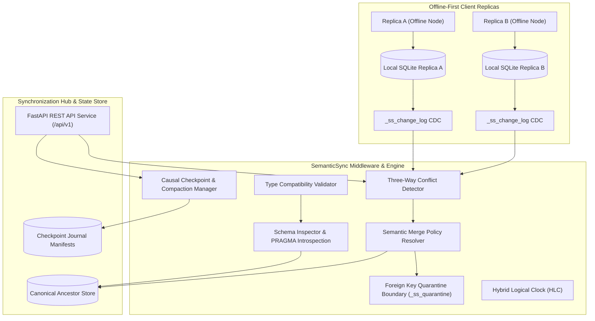

# SemanticSync 🔄

> **A developer workspace for designing, querying, and synchronizing local-first relational databases with schema-level semantic merge policies.**

**Authors:** Pathak Ashmit Akhilesh & Yash Bohra  
**Institution:** Department of Computer Science and Engineering, Vellore Institute of Technology, Vellore  
**Target Venue:** IEEE / Academic Faculty Defense  

---

## 📚 Faculty Defense & Technical Documentation Quick-Access

For reviewing and demonstrating SemanticSync during faculty presentation and technical defense:

| Document | Purpose | Location |
| :--- | :--- | :--- |
| **Presentation Cheatsheet** | 1-page quick reference (pitch, 5 contributions, 10 faculty Q&As, commands) | [`docs/PRESENTATION_CHEATSHEET.md`](docs/PRESENTATION_CHEATSHEET.md) |
| **Live Demonstration Guide** | 8–12 minute minute-by-minute script, pre-demo checklist, 3 live demos, fallbacks | [`docs/DEMO_GUIDE.md`](docs/DEMO_GUIDE.md) |
| **Technical Explanation** | 20-section deep dive (architecture, data flow, 8 policies, HLC, FK quarantine, 26 Q&As) | [`docs/TECHNICAL_EXPLANATION.md`](docs/TECHNICAL_EXPLANATION.md) |
| **Claim-to-Evidence Audit** | Traceability matrix proving all 24 scientific claims against the codebase | [`docs/CLAIM_EVIDENCE_AUDIT.md`](docs/CLAIM_EVIDENCE_AUDIT.md) |
| **Research Literature Index** | Index of all 25 reference papers with licensing and technical connections | [`papers/README.md`](papers/README.md) |
| **Compiled IEEE Paper (PDF)** | Fully compiled 6-page IEEE format research manuscript with 0 overfull hboxes | [`docs/manuscript_latex/IEEE_DEMO_PAPER.pdf`](docs/manuscript_latex/IEEE_DEMO_PAPER.pdf) |
| **IEEE Paper Source (LaTeX)** | LaTeX source file for the IEEE demo paper | [`docs/manuscript_latex/IEEE_DEMO_PAPER.tex`](docs/manuscript_latex/IEEE_DEMO_PAPER.tex) |

---

## 💡 Core Philosophy & Thesis

- **Keep SQL and SQLite:** The underlying storage tier remains standard, embedded SQLite. Developers continue writing ordinary SQL schemas, queries, and transactions.
- **The Core Thesis:** ***Convergence does not equal semantic correctness.*** Traditional CRDT engines achieve state convergence through arbitrary tie-breaking heuristics such as Last-Write-Wins (LWW). While replicas reach identical bytes, valid transactions are silently destroyed (e.g. concurrent sales overwritten instead of added).
- **Domain Independence:** SemanticSync operates purely on relational schemas, SQL datatypes, and declarative merge policies (`SUM`, `BOUNDED_SUM`, `AVG`, `APPEND`, `LWW`, and `REJECT`), never hardcoding business assumptions.

---

## 🏗️ System Architecture



---

## 🚀 Key Features

### 1. Schema-Level Semantic Policies
- **`SUM`**: Additive delta reconciliation from the common ancestor ($v_{\text{base}} + \Delta_A + \Delta_B$) for numeric fields (e.g., inventory counts, account balances).
- **`BOUNDED_SUM`**: Applies tracked signed deltas only when the result stays within inclusive bounds; an unsafe candidate remains pending for review or retry and is never clamped.
- **`AVG`**: Arithmetic mean reconciliation for statistical observations (e.g., sensor telemetry, clinical vital signs).
- **`APPEND`**: Pairwise deterministic text merge; when both values changed, it joins the full values with `; ` in replica-ID order. The implementation does not retain contribution identities or establish general multi-author convergence.
- **`LWW`**: Last-Write-Wins based on Hybrid Logical Clock timestamps with deterministic replica ID tie-breaking.
- **`REJECT`**: Strict safety latch that holds conflicting updates in a pending review state for human intervention (e.g., patient blood types, security roles).
- **`MIN` / `MAX`**: Idempotent extremum bounds.

### 2. Tombstone Merge Policies
Resolves concurrent updates vs. deletions:
- **`FLAG_FOR_REVIEW` (Default)**: Preserves both the update and the deletion in held conflict records for administrative decision.
- **`DELETE_WINS`**: Deletion takes precedence over concurrent updates.
- **`UPDATE_RESURRECTS`**: Concurrent update re-inserts and resurrects the deleted record.

### 3. Transactional Foreign-Key Isolation Boundary
- Tracked mutation, received-operation, conflict-resolution, and quarantine-recovery connections enable SQLite foreign-key enforcement (`PRAGMA foreign_keys = ON`).
- Supported tracked parent deletes quarantine dependent child payloads atomically. Parent-key updates follow the schema's SQLite `ON UPDATE` action; they are not quarantined. SQL-console writes retain FK enforcement but bypass operation logging, quarantine, and the shared process lock.
- Full quarantine inspection, parent relinking (`relink`), and archive confirmation (`confirmed_deleted`) endpoints.

### 4. Operational Checkpoints & Causal Compaction
- Prevents unbounded growth of `_ss_change_log`.
- Computes common acknowledgment horizons across registered replicas.
- **Safety Guarantee:** Compaction is fail-closed. If any enrolled replica's acknowledgment vector is missing, lagging, or corrupted, compaction returns `blocked` or `retained`. **Blocked checkpoints are never reported as compacted.**

### 5. Empirical Benchmark Suite
- **Domain Workload Fixtures:** Inventory, Notes, and Healthcare fixtures support development and API tests. Their resolver-only outputs are illustrative/unvalidated and excluded from empirical comparisons.
- **3×3 Parametric Stress Harness:** Scaled tests across 1,000, 5,000, and 10,000 operations at 5%, 20%, and 50% conflict densities with random seed controls.
- **Artifact Repository:** Direct browser inspection and download of raw JSON and CSV benchmark matrices.

---

## 📁 Repository Structure

```text
SemanticSync/
├── docs/                         # Comprehensive architecture & research docs
│   ├── MANUSCRIPT.md             # Complete academic research paper manuscript
│   ├── ARCHITECTURE.md           # System architecture and data flow
│   ├── POLICY_SPECIFICATION.md   # Algebraic policy definitions and formal rules
│   ├── CONFLICT_MODEL.md         # Conflict taxonomy and row mutation models
│   ├── KNOWN_LIMITATIONS.md      # Factual operational boundaries and constraints
│   └── TRACEABILITY_MATRIX.md    # Requirement to implementation mapping
├── backend/                      # Python backend engine (FastAPI + SQLite3)
│   ├── api/                      # REST API endpoints (/api/v1/...)
│   │   ├── routes_databases.py   # Workspaces and replica management
│   │   ├── routes_policies.py    # Policy configuration and validation
│   │   ├── routes_conflicts.py   # Conflict detection and resolution
│   │   ├── routes_quarantine.py  # Foreign-key quarantine inspection & relinking
│   │   ├── routes_sync.py        # Synchronization, compaction, and checkpoints
│   │   └── routes_benchmark.py   # Benchmark execution and artifact downloads
│   ├── engine/                   # Core synchronization engine
│   │   ├── schema_inspector.py   # SQLite PRAGMA introspection
│   │   ├── policy_registry.py    # Policy catalog and metadata
│   │   ├── policy_validator.py   # Fail-fast datatype validation
│   │   ├── crdt_sync.py          # Three-way CRDT reconciliation pipeline
│   │   ├── fk_quarantine.py      # Foreign key quarantine isolation
│   │   └── checkpoint_store.py   # Causal compaction and snapshot manifests
│   ├── workloads/                # Benchmark workloads & stress harness
│   │   ├── inventory_workload.py # Stock counts, descriptions, SKU policies
│   │   ├── notes_workload.py     # Document collaboration and author tracking
│   │   ├── health_workload.py    # Clinical vital signs and blood type safety
│   │   └── stress_harness.py     # Parametric stress matrix generator
│   ├── tests/                    # Backend pytest suite (latest local run: 332 passed, 1 warning)
│   └── requirements.txt
├── frontend/                     # SemanticSync Studio (React 19 + Vite + Tailwind)
│   ├── src/
│   │   ├── components/           # UI components, layout, TopBar, Sidebar
│   │   ├── context/              # AppContext global state management
│   │   ├── services/api.js       # Typed REST API service layer
│   │   ├── views/                # Views: Dashboard, Schema, Conflicts, Quarantine, Sync, Benchmark
│   │   └── __tests__/            # 10 Vitest integration test cases
│   ├── package.json
│   └── vite.config.js
├── main.py                       # Unified server runner
└── README.md
```

---

## 🛠️ Getting Started & Installation

### Prerequisites
- **Python:** 3.10 or higher (the current Windows verification environment used Python 3.14.3)
- **Node.js:** 20.19+, 22.12+, or 24+ (required by the locked Vite 8 dependency), with npm
- **SQLite:** 3.35 or higher (bundled with standard Python)

### Step 1: Install Backend Dependencies
```bash
python -m pip install -r backend/requirements.txt
```

### Step 2: Install Frontend Dependencies
```bash
cd frontend
npm install
cd ..
```

---

## 🧪 Reproducible Test Execution

### Run Backend Pytest Suite
To execute all backend unit, integration, and property tests:
```bash
python -m pytest backend/tests/ -v
```
Latest local Windows/Python 3.14 run on the current dirty worktree: `py -3.14 -m pytest backend/tests/ -q --tb=short --basetemp .pytest-research-full-13seed-final-20261020 -o faulthandler_timeout=30` completed with **335 passed, 1 warning in 83.94 seconds**. The warning is Starlette's HTTPX/TestClient deprecation. This is environment-specific evidence, not a guaranteed runtime or a clean-checkout build. Earlier runs completed with 332 passed in 77.43 and 78.23 seconds and 334 passed in 81.22 seconds; the original user-reported 309-test result is retained in the Phase 6 audit history.

### Run Frontend Vitest Suite
To execute all frontend component and integration tests:
```bash
cd frontend
npm test
cd ..
```
No current frontend test result is recorded here; run the command above after installing the frontend dependencies.

### Build Frontend Production Assets
To verify clean compilation without linting or bundling errors:
```bash
cd frontend
npm run build
cd ..
```

---

## 📊 Reproducible Benchmark Execution

### Build the research manuscript
`docs/MANUSCRIPT.md` is the canonical manuscript source. The generated HTML and `docs/manuscript_latex/main.tex` are derived versions; the LaTeX output uses the Springer LNCS `llncs` class and `splncs04` bibliography style. Bibliographic records live in `docs/manuscript_latex/references.bib`; the generator's `REFERENCE_KEYS` map connects the Markdown reference numbers to BibTeX keys. When adding a paper, verify its metadata from the paper or an authoritative publisher/repository record, add its BibTeX entry, append its numbered Markdown reference, and add the matching number/key mapping before regenerating. The PDFs in `C:\Users\ASMIT\Downloads\DBMS-REVIEWPAPERS` were used as source material for the added related-work references; they are not copied into the repository. With Python 3.10+:
```bash
python -m pip install reportlab==4.4.9
python research/build_manuscript.py --pdf
```
The PDF is written to `docs/manuscript_latex/SemanticSync-Manuscript.pdf`. `python research/build_manuscript.py` regenerates only HTML and LaTeX. The command does not run benchmarks or alter benchmark artifacts. Confirm the author affiliation wording in the source before external submission.

### Validate the saved repeated-trial artifacts (no rerun)
From the repository root, validate the existing JSON/CSV matrix without running workloads:
```bash
python -m backend.workloads.validate_repeated_benchmark_artifacts
```
This checks the nine configurations, paired trial metadata, digests, alternating order, metrics, paired deltas, and saved summaries. It validates record consistency only; it does not reproduce benchmark measurements. See `research/RESULTS_PROTOCOL.md` for the full validation/reproduction distinction and the expensive matrix command.

### 1. Domain Scenario Fixtures (Not Comparative Measurements)
The domain workload classes create SQLite fixtures for API and integration testing. The former `/benchmark/run` implementation called the resolver directly, used a replica-B LWW proxy, and emitted hard-coded convergence fields. The current endpoint returns `evaluation_status="illustrative_unvalidated"`; comparative metric fields are null. Its output is not empirical evidence of comparative performance or convergence.
```bash
python -c "from backend.workloads.inventory_workload import InventoryWorkload; w = InventoryWorkload(); w.setup(); print('Inventory ready')"
```

### 2. Three-by-three Parametric Stress Benchmark
Run the scaled parametric stress harness (e.g. 1,000 operations at 20% conflict density):
```bash
curl -X POST http://127.0.0.1:8000/api/v1/benchmark/stress -H "Content-Type: application/json" -d "{\"num_operations\": 1000, \"conflict_density\": 0.20, \"seed\": 42, \"export_artifacts\": true}"
```
Artifacts are automatically persisted as JSON and CSV in `data/benchmarks/` and can be retrieved via `GET /api/v1/benchmark/artifacts`.

Stress SCR scores only conflict-row final values across both replicas (N/A when there are no conflicts). Benchmark-row agreement compares only `bench_rows.value`, not the complete database; stress VRA is N/A for this synthetic workload. Reported sync delta is end-to-end batch time difference, not resolver-only latency.

---

## 💻 Running the Application

### Option A — Unified Runner (Recommended)
Starts both the FastAPI backend and the Vite frontend simultaneously:
```bash
python main.py --with-frontend
```

### Option B — Separate Processes
- **Backend Terminal:**
  ```bash
  python main.py
  ```
  - API Server: `http://127.0.0.1:8000`
  - Interactive OpenAPI Docs: `http://127.0.0.1:8000/docs`

- **Frontend Terminal:**
  ```bash
  cd frontend
  npm run dev
  ```
  - Studio UI: `http://localhost:5173`
  - Automated proxy forwards `/api` requests to port `8000`.

For the tested UI walkthrough, isolated demo-data setup, deterministic scenario values, and limitations, see [docs/DEMO_GUIDE.md](docs/DEMO_GUIDE.md). The backend seeds sample workspaces only for an empty registry; use a new `SEMANTICSYNC_DATA_DIR` for a clean demo rather than re-seeding a directory with operation history.

---

## 📜 REST API Reference

| Method | Endpoint | Description |
|---|---|---|
| `GET` | `/api/v1/databases` | List all database workspaces |
| `POST` | `/api/v1/databases` | Register a new database workspace |
| `GET` | `/api/v1/databases/{id}/schema` | Introspect table and column metadata |
| `GET` | `/api/v1/databases/{id}/policies` | Retrieve assigned semantic policies |
| `PUT` | `/api/v1/databases/{id}/policies` | Batch update policy assignments with type validation |
| `POST` | `/api/v1/validate-policy` | Validate single policy against column datatype |
| `GET` | `/api/v1/conflicts` | List active divergences with row mutation models |
| `POST` | `/api/v1/conflicts/resolve` | Resolve conflict (`auto`, `pick_a`, `pick_b`, `custom`) |
| `GET` | `/api/v1/quarantine` | List orphaned child records in foreign key quarantine |
| `POST` | `/api/v1/quarantine/{qid}/resolve`| Relink orphaned row to parent or confirm deletion |
| `GET` | `/api/v1/sync/status` | Get synchronization engine and checkpoint status |
| `POST` | `/api/v1/sync/run` | Execute 3-way synchronization with tombstone policy |
| `POST` | `/api/v1/sync/checkpoint-store/initialize` | Provision or adopt durable checkpoint journal |
| `POST` | `/api/v1/sync/compact` | Causal compaction up to common replica ACK horizon |
| `POST` | `/api/v1/query` | Execute SQL queries in SQLite console |
| `POST` | `/api/v1/benchmark/run` | Return illustrative, unvalidated domain-run status |
| `POST` | `/api/v1/benchmark/stress` | Run parametric stress benchmark |
| `GET` | `/api/v1/benchmark/artifacts` | List recorded JSON/CSV benchmark artifacts |
| `GET` | `/api/v1/benchmark/artifacts/{file}` | Download specific benchmark artifact file |

---

## ⚠️ Known Operational Boundaries & Limitations

In accordance with strict scientific integrity, SemanticSync explicitly documents its boundaries:
1. **Single-Process Coordination:** Database mutations and causal log compactions are protected by an in-process serialized lock (`mutation_lock.py`). The system is optimized as an embedded edge middleware rather than a multi-process distributed server.
2. **Direct SQL Boundary:** SQL-console and external-process writes are not recorded as tracked operations and do not run the quarantine workflow. Console connections enable foreign keys, but schema-declared cascades may still delete dependent rows without quarantine; external clients may also disable foreign keys.
3. **Single-Column Primary Keys:** Synchronization requires tables to have a single-column primary key. Tables with composite primary keys are safely skipped (`skipped_tables`).
4. **Quarantine Review Requirement:** Supported tracked parent-delete paths quarantine dependent payloads, which remain isolated until an administrator relinks or confirms deletion. Parent-key updates follow SQLite's declared `ON UPDATE` action. Composite parent keys and `WITHOUT ROWID` dependent tables are unsupported by the tracked quarantine path and fail closed.
5. **Synthetic Resolver Benchmark Scope:** Benchmarks evaluate resolver accuracy against generated divergence pairs; they do not certify arbitrary distributed mesh convergence across cyclic partition schedules.

---

## 📄 License
Academic and Research Open Source License.
